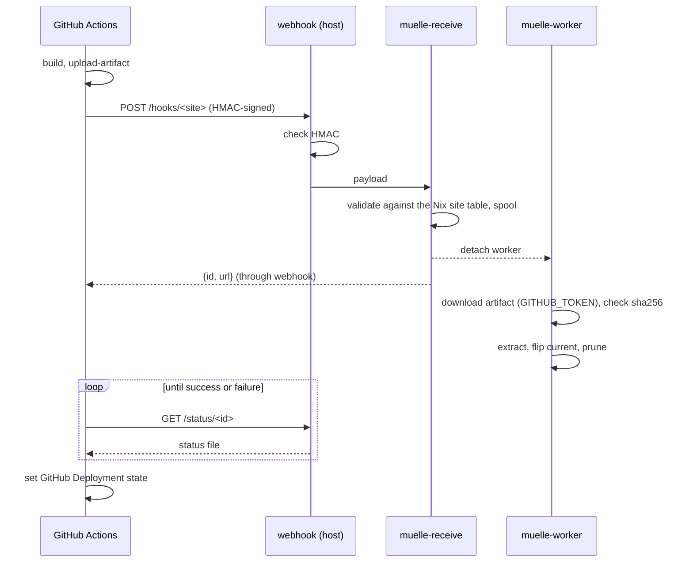

# Architecture

## Pull, not push

CI never gets shell access to the host and never applies NixOS
configuration. It can only ask the host to fetch a build of a site the
NixOS module declares, into an environment the module allows. The module is
the only authority on which sites, environments and paths exist; the
payload only picks among them.

## Pieces

- Receiver: [adnanh/webhook](https://github.com/adnanh/webhook) via
  `services.webhook`, one hook per site, `payload-hmac-sha256` rule, secret
  loaded with systemd `LoadCredential`. Once the signature checks out it runs
  `muelle-receive` ([`muelle.receive`](../reference/python/receive.md)),
  which validates the payload against the site table generated by the
  module, writes it to the spool, detaches the worker and answers with the
  job's id and URL.
- Worker ([`muelle.worker`](../reference/python/worker.md)): downloads the
  artifact, checks its sha256, extracts it safely into a new release, flips
  the slot's `current` symlink, prunes old releases and previews, and keeps
  the status file updated.
- Client ([`muelle.client`](../reference/python/client.md)): run by the
  composite action; signs the payload, polls `/status/#lt;id#gt;` until the job
  ends, and reports GitHub Deployment state.
- Listing ([`muelle.index`](../reference/python/index.md)): static
  `index.html` and `index.json`, regenerated on every hook request and daily.
- Admin CLI ([`muelle.cli`](../reference/python/cli.md)): the same
  operations from the host, without CI.

All of it is one Python package without runtime dependencies. The client
imports only [`muelle.protocol`](../reference/python/protocol.md) and the
standard library, so the action runs it straight from the checkout.

## Credentials

The host holds no GitHub credentials. The workflow's short-lived
`GITHUB_TOKEN` is passed in the signed payload and used only to download the
artifact, which must live under `https://api.github.com/repos/<repo>/` of the
site's repo. The token stays valid while the action waits for the host.

## Layout

`<baseDir>/<site>/<slot>/releases/<sha>` plus a `current` symlink. Slots are
`prod`, `next`, and an 8-hex hash of site + branch + sha per preview. Static
content needs no nginx reload: the symlink flip is atomic. See
[Operating the host](../guides/operating.md#where-things-live).
