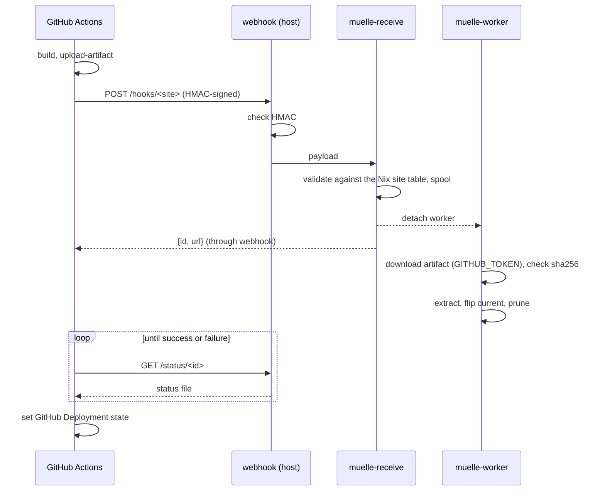

# muelle

Pull-based CI/CD for static sites on a NixOS host.

GitHub Actions builds the site and uploads it as a workflow artifact. The
muelle composite action sends an HMAC-signed request to the host; the host
fetches the artifact, verifies it and flips a symlink. CI never gets shell
access and never applies NixOS configuration: the NixOS module is the only
authority on which sites, environments and paths exist.

Status: prototype. Static sites only.

## Where to start

- [Host setup](getting-started/host-setup.md) and
  [Your first workflow](getting-started/first-workflow.md) get a site deployed.
- The guides cover [environments](guides/environments.md),
  [gating previews](guides/previews.md), [the listing](guides/listing.md),
  [operating the host](guides/operating.md) and
  [migrating an existing site](guides/migrating.md).
- [Architecture](explanation/architecture.md) and
  [Security model](explanation/security.md) explain why it works the way it does.
- The reference is generated from its sources:
  [NixOS options](reference/options.md), [action inputs](reference/action.md),
  [admin CLI](reference/cli.md) and the [Python modules](reference/python/client.md).

## Not yet

- Uploading the artifact in the request body (fallback when the token cannot fetch it).
- Node/JVM apps, WordPress.
- Marking GitHub deployments inactive on teardown.
